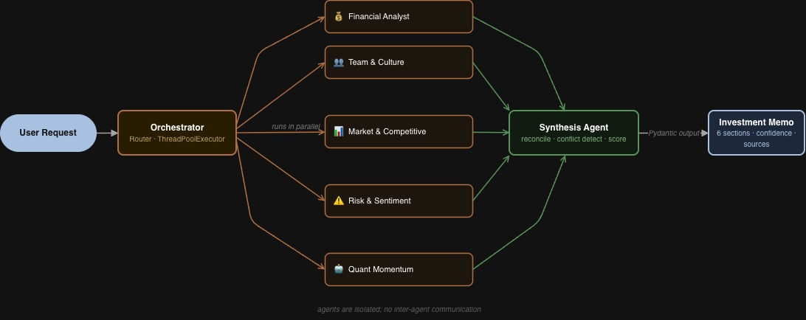

# DeepDiligence

Multi-agent AI system for investment due diligence. Give it a company — it runs five specialist agents in parallel, synthesizes their findings into a sourced investment memo, ranks stocks weekly, and builds portfolio allocations with live prices and S&P 500 benchmarking.

Built for Cornell ENMGT5400 (Applications of AI for Engineering Managers), April 2026.

---

## What It Does

- **Analyse a company** — five specialist agents run concurrently and produce a six-section investment memo in ~2 minutes
- **Weekly rankings** — screen a curated 95-stock universe, run batch diligence, generate BUY/HOLD/SELL ratings
- **Portfolio builder** — allocate a dollar amount across AI-rated picks with live prices, confidence-weighted allocation, and S&P 500 benchmark comparison

---

## Architecture

Router / Aggregator pattern. The orchestrator dispatches all five agents in parallel via `ThreadPoolExecutor`. Agents are fully isolated — they cannot communicate with each other. Synthesis runs only after all five complete.

```
User Request
    └── Orchestrator (Router)
            ├── Financial Analyst       → SEC 10-K/10-Q, margins, cash flow
            ├── Team & Culture          → hiring velocity, leadership signals
            ├── Market & Competitive    → TAM, moat, competitor mapping
            ├── Risk & Sentiment        → news sentiment, litigation, macro exposure
            └── Quant Momentum          → Random Forest ML on 3yr OHLCV + 14 indicators
                        │
                        ▼
              Synthesis Agent (Aggregator)
              reconcile · conflict detect · confidence score
                        │
                        ▼
              Investment Memo (Pydantic)
              6 sections · source IDs · per-claim traceability
```



> Source: `DeepDiligence_Architecture.xml` (draw.io)

---

## The Five Agents

| Agent | Data Sources | Output |
|-------|-------------|--------|
| **Financial Analyst** | SEC EDGAR (10-K, 10-Q), investor-relations pages | Revenue trends, margin signals, debt structure |
| **Team & Culture** | Job postings, leadership announcements | Hiring velocity, org change signals |
| **Market & Competitive** | News, competitor sites, industry reports | TAM estimate, moat assessment, positioning |
| **Risk & Sentiment** | NewsAPI, regulatory filings, litigation data | Sentiment score, risk flags, tail risks |
| **Quant Momentum** | yfinance (3yr OHLCV) | Random Forest prediction, 14 technical indicators, holdout accuracy |

The **Synthesis Agent** receives only typed Pydantic sub-reports — never raw documents. Every claim in the memo carries at least one `source_id`. Unsourceable claims are flagged, not included.

---

## Portfolio Builder — Backtest

$10,000 allocated using AI-rated picks from Jan 2024 to May 2026:

| Stock | Rating | Jan '24 | Today | Return | P&L |
|-------|--------|---------|-------|--------|-----|
| ISRG | STRONG BUY | $330.98 | $457.61 | +38.3% | +$1,275 |
| LLY | BUY | $583.03 | $934.60 | +60.3% | +$2,010 |
| SHOP | BUY | $73.83 | $121.13 | +64.1% | +$2,136 |
| **Portfolio** | | **$10,000** | **$15,421** | **+54.2%** | **+$5,421** |
| S&P 500 | Benchmark | | | +52.0% | |

**Alpha: +2.2 percentage points.** Portfolio weights are computed as `suggested_weight_pct × rating_boost × confidence`, capped per position and normalised. Live prices fetched via yfinance on every request.

---

## Tech Stack

| Layer | Tech |
|-------|------|
| Backend | Python 3.11, FastAPI, uvicorn |
| LLM | Claude via the Claude Code CLI (`claude -p`), `claude-opus-5-5` by default |
| ML | scikit-learn RandomForestClassifier, numpy |
| Market Data | yfinance |
| Frontend | React, TypeScript, TanStack Router, Tailwind CSS |
| Streaming | Server-Sent Events (SSE) — real-time agent progress |
| Caching | Disk-based, SHA256-keyed JSON per agent |
| Data Sources | SEC EDGAR, NewsAPI, web scraping (BeautifulSoup) |

---

## Setup

Requires Python 3.11+ and Node 18+.

**Backend**

```bash
python3.11 -m venv .venv
source .venv/bin/activate
pip install -r requirements.txt
cp .env.example .env   # fill in your keys
```

`.env` keys:

```
NEWS_API_KEY=...
SEC_EDGAR_USER_AGENT="DeepDiligence your-email@example.com"
```

There is no LLM API key. Every LLM call runs through the [Claude Code CLI](https://claude.com/claude-code): install it, run `claude` once to log in, and the backend uses that login. Optional overrides: `DD_AGENT_MODEL`, `DD_SYNTHESIS_MODEL`, `CLAUDE_CLI_PATH`.

SEC EDGAR requires a descriptive User-Agent with a contact email.

**Frontend**

```bash
cd frontend
npm install
```

---

## Running

```bash
# Backend (from repo root)
uvicorn api:app --port 8000

# Frontend (from /frontend)
npm run dev
```

Frontend runs at `http://localhost:5173`. Backend at `http://localhost:8000`.

The legacy Streamlit interface (`app.py`) still works if you prefer it:

```bash
streamlit run app.py
```

---

## Key Files

| Path | Purpose |
|------|---------|
| `api.py` | FastAPI backend — REST + SSE endpoints |
| `src/orchestrator.py` | Parallel agent dispatch + synthesis coordination |
| `src/agents/financial.py` | Financial Analyst agent |
| `src/agents/team.py` | Team & Culture agent |
| `src/agents/market.py` | Market & Competitive agent |
| `src/agents/risk.py` | Risk & Sentiment agent |
| `src/agents/quantitative.py` | Quant Momentum agent (Random Forest ML) |
| `src/agents/synthesis.py` | Synthesis + conflict detection + confidence scoring |
| `src/models/schemas.py` | Pydantic v2 contracts for all inter-agent data |
| `src/models/prompts.py` | All agent system prompts |
| `src/scheduler/portfolio_builder.py` | Portfolio allocation + live pricing + S&P 500 benchmark |
| `src/scheduler/recommender.py` | Weekly report generation + stock ranking |
| `src/scheduler/screener.py` | 95-stock curated universe + live screener |
| `src/data/price_history.py` | yfinance download + 14 technical indicator engineering |
| `data/stock_universe.json` | 95 stocks tagged by sector and investment style |
| `frontend/src/routes/` | Page components: analyze, weekly, portfolio, index |
| `DeepDiligence_Architecture.xml` | draw.io architecture diagram |

---

## API Endpoints

| Method | Path | Description |
|--------|------|-------------|
| GET | `/api/health` | Health check |
| GET | `/api/universe` | Full 95-stock universe with styles and sectors |
| GET | `/api/weekly-report` | Latest saved weekly report |
| GET | `/api/weekly-report/all` | All historical reports |
| POST | `/api/analyze` | SSE stream — full 5-agent pipeline for one company |
| POST | `/api/weekly-report/generate` | SSE stream — batch pipeline + rankings |
| POST | `/api/portfolio/build` | JSON — portfolio allocation from latest weekly report |

---

## Caching

**Caching is off by default**, so every analysis gathers live data and makes fresh LLM calls. Set `DD_USE_CACHE=1` to turn the disk cache back on. When enabled, expensive calls cache under `data/cache/` (excluded from git):

| Path | Contents |
|------|---------|
| `data/cache/agents/` | Per-agent Pydantic sub-reports (keyed by SHA256 of company + ticker) |
| `data/cache/memos/` | Full synthesized memos |
| `data/cache/news/` | NewsAPI responses |
| `data/cache/edgar/` | SEC EDGAR API responses |
| `data/cache/web/` | Scraped pages |

---

## Limitations

- Private companies have limited coverage — no SEC EDGAR filings
- Quant agent requires a ticker and at least 120 days of public price history
- NewsAPI free tier is 100 req/day and results are no longer cached; once it is exhausted the agents fall back to web search
- A full analysis takes several minutes, because each run researches from scratch through the Claude CLI
- Web scraping is best-effort; JS-heavy or bot-blocking pages may return partial data
- Portfolio Builder requires a weekly report to exist — generate one first

---

## What's Next

- RAG-based faithfulness verifier using ChromaDB (already in stack) to check claims against raw sources
- Cross-week memory — track how a thesis evolves across weekly reports
- Post-memo Q&A interface against the raw source corpus
- Expand beyond 95 stocks
